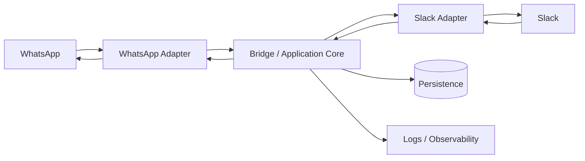
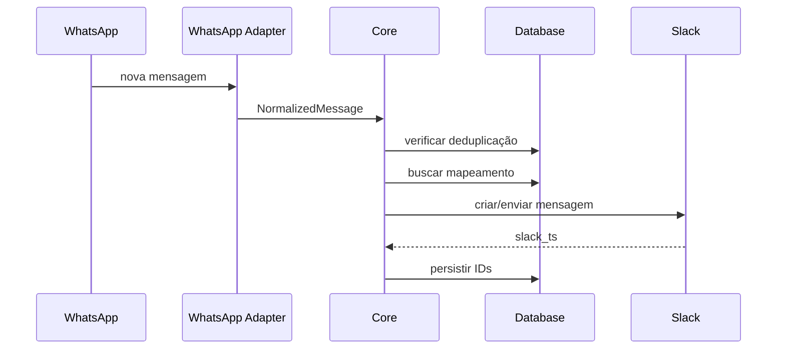
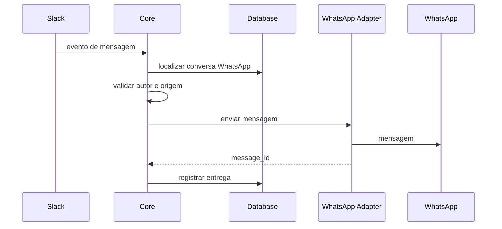
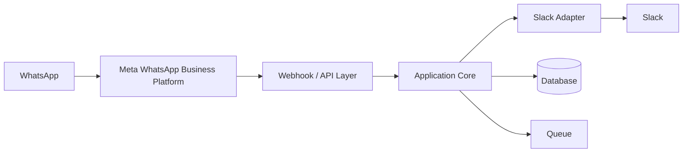

# Planejamento Técnico — Integração Slack ↔ WhatsApp

> **Status:** documento-base para prova de conceito, revisão de repositório e futura evolução para produção  
> **Data de referência:** 22/09/2026  
> **Objetivo inicial:** executar uma integração bidirecional em ambiente local, de baixo custo, utilizada somente por membros internos da equipe, sem depender inicialmente do ChatArchitect ou da WhatsApp Business Platform oficial.

---

## Estado atual da implementação e laboratório VPS (15/10/2026)

A aplicação está em `upstream/WhatsAppInSlack`: Slack Bolt em Socket Mode normaliza mensagens e usa `MessageRouter` para restringir o canal e resolver threads para conversas no `MockWhatsAppAdapter`. A instalação Slack é configurada por variáveis de ambiente e suporta um workspace por execução; a configuração atual usa o workspace de laboratório/pessoal. O setup do workspace corporativo está descrito em `docs/deployment/SLACK_WORKSPACE_SETUP.md`, com manifesto Slack reutilizável. OAuth e execução simultânea em vários workspaces ainda não estão implementados. O mock persiste os mappings de threads e as últimas 500 mensagens em JSON dentro do volume Docker `lion-whatsapp-lab_mock_state`; nenhum cliente ou conta WhatsApp real é iniciado. Os 13 testes offline cobrem roteamento e persistência, sem depender de credenciais ou rede. O laboratório `lion-whatsapp-lab` está publicado no VPS `179.198.97.107`, com HTTP limitado a `127.0.0.1:3000`. A thread de teste continuou mapeada após reinício; respostas humanas chegaram ao mock e foram persistidas. Mídia, deduplicação e integração com WhatsApp real continuam pendentes. O container usa usuário não root, filesystem raiz somente leitura, `/tmp` temporário e sem capabilities adicionais.

## 1. Objetivo deste documento

Este documento define uma proposta de arquitetura, etapas de implementação, riscos, critérios técnicos e recomendações para um projeto de integração entre Slack e WhatsApp.

O objetivo imediato não é construir uma solução definitiva de produção. A primeira etapa deve funcionar como uma **prova de conceito (PoC)** capaz de responder às seguintes perguntas:

1. A equipe realmente ganha produtividade ao centralizar mensagens do WhatsApp no Slack?
2. O modelo de canais, threads e identificação de conversas funciona para o fluxo interno?
3. A integração é estável o suficiente para um teste controlado?
4. Quais funcionalidades são realmente necessárias antes de investir em uma integração oficial?
5. Quanto do código pode ser reaproveitado caso o projeto migre posteriormente para a API oficial da Meta?

A recomendação central é tratar a integração do WhatsApp como um **adaptador substituível**, e não como parte inseparável da aplicação. Assim, uma biblioteca não oficial pode ser utilizada durante a PoC sem comprometer a arquitetura futura.

---

# 2. Resumo executivo

Para a fase inicial, a arquitetura recomendada é:

```text
WhatsApp de teste
        │
        │ WhatsApp Web
        ▼
WPPConnect Server
ou whatsapp-web.js
        │
        ▼
Bridge da aplicação
        │
        │ Slack Bolt / Socket Mode
        ▼
Workspace Slack de teste
```

A aplicação deve rodar localmente, preferencialmente por Docker Compose.

Para o Slack, recomenda-se utilizar **Slack Bolt for JavaScript em Socket Mode**. O Socket Mode permite que a aplicação local receba eventos por WebSocket, evitando a necessidade de publicar um endpoint HTTP na internet apenas para o teste.

Para o WhatsApp, durante a PoC, podem ser avaliadas:

- WPPConnect Server;
- WPPConnect;
- whatsapp-web.js.

Essas opções são **não oficiais** e utilizam ou automatizam o WhatsApp Web. Por isso devem ser tratadas apenas como mecanismos de experimentação e não como garantia de uma solução definitiva.

A arquitetura deve permitir uma futura substituição:

```text
Hoje:
Slack ↔ Core da aplicação ↔ WPPConnect / whatsapp-web.js

Futuro:
Slack ↔ Core da aplicação ↔ WhatsApp Business Platform / Cloud API
```

O código do Slack e as regras de negócio devem continuar praticamente independentes do provedor utilizado para acessar o WhatsApp.

---

# 3. Premissas atuais do projeto

Este planejamento considera inicialmente:

- uso interno;
- workspace Slack pessoal/de laboratório durante o piloto; a migração para o workspace corporativo está planejada;
- número de WhatsApp dedicado ou descartável para teste;
- hospedagem local;
- baixo volume de mensagens;
- sem requisitos formais de SLA;
- sem necessidade inicial de alta disponibilidade;
- sem necessidade inicial de dashboard administrativo;
- sem necessidade inicial de múltiplos clientes/empresas;
- sem necessidade inicial de integração com CRM;
- equipe técnica com liberdade para alterar o código;
- possibilidade futura de migração para infraestrutura em nuvem e API oficial.

---

# 4. O que deve ser considerado fora de escopo no primeiro MVP

O primeiro MVP não deve tentar resolver tudo.

Recomenda-se deixar inicialmente fora de escopo:

- campanhas de marketing;
- envio em massa;
- CRM;
- chatbot com IA;
- múltiplos números de WhatsApp;
- execução simultânea em múltiplos workspaces Slack e fluxo OAuth de distribuição;
- gestão avançada de permissões;
- dashboards;
- métricas complexas;
- alta disponibilidade;
- balanceamento horizontal;
- filas distribuídas;
- gestão de templates oficiais da Meta;
- sincronização completa do histórico;
- edição/deleção bidirecional perfeita;
- reações e stickers em todas as direções;
- chamadas de voz/vídeo.

A meta do MVP deve ser:

> **receber uma mensagem de WhatsApp no Slack e conseguir responder a essa conversa pelo Slack de forma confiável.**

---

# 5. Arquitetura recomendada

## 5.1 Princípio mais importante: separar integrações do núcleo

Evitar:

```text
app.js
 ├─ lógica do Slack
 ├─ lógica do WhatsApp
 ├─ banco
 ├─ mídia
 ├─ regras de negócio
 ├─ autenticação
 ├─ conversão de arquivos
 └─ tratamento de erros
```

Esse desenho funciona em uma demonstração pequena, mas fica difícil de testar, manter ou migrar.

Preferir:

```text
src/
├── application/
├── domain/
├── adapters/
│   ├── slack/
│   └── whatsapp/
├── infrastructure/
├── persistence/
└── config/
```

O núcleo da aplicação não deve saber se o WhatsApp está sendo acessado via:

- WPPConnect;
- whatsapp-web.js;
- Baileys;
- ChatArchitect;
- Meta Cloud API.

Ele deve conhecer somente uma interface genérica.

---

# 6. Arquitetura lógica proposta



Responsabilidades:

### WhatsApp Adapter

Responsável por:

- conectar ao WhatsApp;
- receber mensagens;
- enviar mensagens;
- baixar mídia;
- identificar conversa;
- identificar remetente;
- sinalizar conexão/desconexão;
- transformar eventos específicos do provedor em objetos internos.

### Slack Adapter

Responsável por:

- conectar ao Slack;
- receber eventos;
- publicar mensagens;
- criar threads;
- fazer upload de arquivos;
- recuperar informações do usuário;
- tratar rate limits.

### Core

Responsável por:

- roteamento;
- regras de mapeamento;
- deduplicação;
- prevenção de loops;
- persistência de relacionamentos;
- decisão de destino;
- retries;
- autorização.

---

# 7. Interfaces recomendadas

Exemplo conceitual:

```ts
interface MessagingAdapter {
  connect(): Promise<void>;
  disconnect(): Promise<void>;
  sendMessage(message: OutboundMessage): Promise<SendResult>;
  onMessage(handler: MessageHandler): void;
}
```

Modelo interno:

```ts
type NormalizedMessage = {
  id: string;
  platform: "slack" | "whatsapp";
  conversationId: string;
  senderId: string;
  senderName?: string;
  text?: string;
  timestamp: Date;
  attachments?: Attachment[];
  replyTo?: string;
};
```

A vantagem é permitir:

```text
WPPConnectMessage
        ↓
normalize()
        ↓
NormalizedMessage
        ↓
regra de negócio
        ↓
SlackMessage
```

Posteriormente:

```text
MetaCloudApiMessage
        ↓
normalize()
        ↓
NormalizedMessage
```

O restante da aplicação não precisa mudar.

---

# 8. Fase 1 — implementação local

## 8.1 Stack recomendada

### Aplicação

- Node.js LTS;
- TypeScript preferencialmente;
- Slack Bolt for JavaScript;
- Docker;
- Docker Compose.

### WhatsApp

Opção recomendada para a primeira prova:

- WPPConnect Server em container.

Alternativa:

- whatsapp-web.js diretamente dentro da aplicação.

### Persistência

Para o primeiro teste:

- SQLite;

ou, se o repositório já utiliza MongoDB:

- MongoDB local via Docker.

SQLite reduz bastante a complexidade para um MVP.

### Logs

- Pino;
- Winston;
- ou logger estruturado equivalente.

Não depender apenas de `console.log`.

---

# 9. Por que utilizar Slack Socket Mode

No fluxo tradicional do Slack Events API, a aplicação recebe requisições HTTP em um endpoint público.

Para um servidor local isso normalmente exigiria:

```text
Slack
  │
Internet
  │
ngrok / tunnel
  │
localhost
```

Com Socket Mode:

```text
localhost
   │
WebSocket iniciado pela própria aplicação
   │
Slack
```

O Slack documenta oficialmente que o Socket Mode recebe eventos por uma conexão WebSocket e que, no Bolt for JavaScript, pode ser habilitado com `socketMode: true` e um App-Level Token.

Isso torna o Socket Mode especialmente adequado para a PoC.

---

# 10. Fluxo básico do MVP

## 10.1 WhatsApp → Slack



## 10.2 Slack → WhatsApp



---

# 11. Estratégias de organização das conversas

Há três modelos principais.

## Modelo A — um canal por grupo/conversa

```text
#whatsapp-equipe-a
#whatsapp-equipe-b
#whatsapp-operacoes
```

### Vantagens

- visualmente simples;
- permissões do Slack podem ser utilizadas;
- fácil entendimento.

### Desvantagens

- muitos canais quando o volume cresce;
- criação automática de canais aumenta complexidade.

---

## Modelo B — um canal central + uma thread por conversa

```text
#whatsapp

├─ thread: Grupo Financeiro
├─ thread: João Silva
├─ thread: Projeto X
└─ thread: Operações
```

### Vantagens

- organização compacta;
- parecido com o comportamento do repositório WhatsAppInSlack;
- bom para MVP.

### Desvantagens

- precisa persistir a relação:

```text
whatsapp_chat_id → slack_thread_ts
```

- threads antigas podem ficar difíceis de localizar.

### Recomendação inicial

Para o projeto atual:

> **um canal Slack dedicado + uma thread por conversa do WhatsApp.**

---

# 12. Estrutura de diretórios recomendada

```text
slack-whatsapp-bridge/
│
├── src/
│   ├── main.ts
│   │
│   ├── application/
│   │   ├── message-router.ts
│   │   ├── conversation-service.ts
│   │   └── media-service.ts
│   │
│   ├── domain/
│   │   ├── message.ts
│   │   ├── conversation.ts
│   │   └── attachment.ts
│   │
│   ├── adapters/
│   │   ├── slack/
│   │   │   ├── slack.adapter.ts
│   │   │   └── slack.mapper.ts
│   │   │
│   │   └── whatsapp/
│   │       ├── whatsapp.adapter.ts
│   │       ├── wppconnect.adapter.ts
│   │       └── whatsapp.mapper.ts
│   │
│   ├── persistence/
│   │   ├── conversation.repository.ts
│   │   └── message.repository.ts
│   │
│   ├── infrastructure/
│   │   ├── database.ts
│   │   ├── logger.ts
│   │   └── retry.ts
│   │
│   └── config/
│       └── env.ts
│
├── tests/
│   ├── unit/
│   └── integration/
│
├── docker-compose.yml
├── Dockerfile
├── .env.example
├── .gitignore
├── package.json
├── tsconfig.json
└── README.md
```

---

# 13. Variáveis de ambiente

Nunca inserir tokens no código.

Exemplo:

```env
NODE_ENV=development

SLACK_BOT_TOKEN=xoxb-...
SLACK_APP_TOKEN=xapp-...
SLACK_CHANNEL_ID=C0123456789

WHATSAPP_PROVIDER=wppconnect
WPP_BASE_URL=http://wppconnect:21465
WPP_SECRET=change-me
WPP_SESSION=slack-bridge

DATABASE_URL=file:./data/app.db

LOG_LEVEL=info
```

O arquivo real:

```text
.env
```

deve estar no `.gitignore`.

O repositório deve conter somente:

```text
.env.example
```

sem credenciais reais.

---

# 14. Docker Compose sugerido

Estrutura conceitual:

```yaml
services:

  bridge:
    build: .
    env_file:
      - .env
    depends_on:
      - wppconnect
    restart: unless-stopped

  wppconnect:
    image: wppconnect/wppconnect-server:<versao-fixada>
    restart: unless-stopped
    volumes:
      - wpp_tokens:/usr/src/wpp-server/tokens
      - wpp_userdata:/usr/src/wpp-server/userDataDir

volumes:
  wpp_tokens:
  wpp_userdata:
```

Durante desenvolvimento pode ser útil publicar a porta local do WPPConnect.

Em produção, evitar expor desnecessariamente:

```text
21465
```

para a internet.

---

# 15. Não utilizar `latest` em produção

Durante experimentação:

```text
wppconnect/wppconnect-server:latest
```

pode ser aceitável.

Depois que o teste estiver funcionando, fixar versão:

```text
wppconnect/wppconnect-server:X.Y.Z
```

Motivo:

uma atualização automática pode alterar o comportamento da integração do WhatsApp Web e quebrar o sistema sem alteração do nosso código.

O próprio WPPConnect Server oferece tags de versão para esse objetivo.

---

# 16. QR Code e persistência de sessão

Na primeira execução:

```text
WPPConnect
   ↓
gera QR
   ↓
WhatsApp do celular
   ↓
Dispositivos conectados
   ↓
Ler QR
```

Após pareamento, os dados da sessão devem ser persistidos em volume Docker.

Sem persistência:

```text
docker down
   ↓
sessão perdida
   ↓
novo QR
```

Com volume:

```text
container reinicia
   ↓
sessão reutilizada
```

Nunca versionar dados de sessão no Git.

---

# 17. Controle de loop

Esse é um requisito crítico.

Sem proteção:

```text
WhatsApp
   ↓
Slack
   ↓
bridge detecta mensagem do próprio bot
   ↓
WhatsApp
   ↓
Slack
   ↓
...
```

A aplicação deve identificar mensagens geradas por ela mesma.

No Slack:

- ignorar eventos do próprio bot;
- validar `bot_id`;
- validar usuário/app de origem.

No WhatsApp:

- ignorar mensagens `fromMe` quando apropriado;
- armazenar IDs gerados pela integração.

---

# 18. Deduplicação

Mensageria real pode entregar eventos mais de uma vez.

Criar uma chave:

```text
provider + external_message_id
```

Exemplo:

```text
whatsapp:3EB0ABC123
slack:1727050000.123456
```

Antes de processar:

```sql
SELECT id
FROM processed_messages
WHERE external_id = ?
```

Se já existir, ignorar.

Adicionar índice `UNIQUE`.

---

# 19. Tabela de mapeamento

Estrutura mínima:

```text
conversation_mapping
--------------------
id
whatsapp_chat_id
slack_channel_id
slack_thread_ts
created_at
updated_at
active
```

Tabela de mensagens:

```text
message_mapping
---------------
id
source_platform
source_message_id
target_platform
target_message_id
conversation_id
created_at
status
```

Isso permitirá no futuro:

- replies;
- deleções;
- edição;
- reações;
- auditoria;
- investigação de falhas.

---

# 20. Mídias e arquivos

Não começar o desenvolvimento por mídia.

Ordem recomendada:

1. texto;
2. imagens;
3. documentos;
4. áudio;
5. vídeo;
6. replies;
7. reações/stickers.

Arquivos temporários devem ser apagados depois do processamento.

Evitar:

```text
/downloads
```

crescendo indefinidamente.

Preferir:

```text
temp file
→ processa
→ envia
→ remove
```

Para produção:

- limite máximo de tamanho;
- validação de MIME type;
- timeout;
- política de retenção.

---

# 21. Tratamento de erros

Nunca fazer apenas:

```js
try {
  ...
} catch (error) {
  console.error(error);
}
```

e considerar o evento resolvido.

Separar erros:

```text
TransientError
PermanentError
AuthenticationError
RateLimitError
UnsupportedMessageError
```

Exemplo:

```text
Slack 429
   ↓
RateLimitError
   ↓
aguardar Retry-After
   ↓
reenviar
```

---

# 22. Retry e fila

Na PoC, uma fila em memória pode ser suficiente.

Para produção, considerar:

- Redis + BullMQ;
- RabbitMQ;
- SQS;
- outro mecanismo de fila durável.

Fluxo:

```text
evento
  ↓
persistir
  ↓
fila
  ↓
processar
  ↓
enviar
  ↓
confirmar
```

Isso evita perda de mensagens quando Slack ou WhatsApp ficam temporariamente indisponíveis.

---

# 23. Logs recomendados

Formato estruturado:

```json
{
  "level": "info",
  "event": "message_forwarded",
  "source": "whatsapp",
  "target": "slack",
  "conversationId": "...",
  "messageId": "...",
  "durationMs": 183
}
```

Evitar registrar:

- tokens;
- secrets;
- cookies;
- QR codes;
- conteúdo integral de conversas em produção;
- dados pessoais sem necessidade.

---

# 24. Segurança mínima para a PoC

Mesmo sendo uma PoC interna:

- usar número de WhatsApp separado;
- não utilizar número corporativo crítico;
- usar workspace Slack de teste;
- usar tokens com menor privilégio possível;
- nunca fazer commit de `.env`;
- persistir sessão do WhatsApp fora do repositório;
- não expor WPPConnect para a internet;
- não expor MongoDB;
- não publicar QR code;
- limitar quem pode responder pelo Slack;
- criar `.gitignore` adequado;
- rotacionar credenciais caso sejam acidentalmente publicadas.

---

# 25. Princípio de menor privilégio no Slack

O Slack App deve receber somente scopes realmente necessários.

Durante a implementação, registrar cada scope e a justificativa.

Exemplo conceitual:

| Permissão | Motivo |
|---|---|
| `chat:write` | enviar mensagens |
| leitura de mensagens do canal | receber respostas |
| leitura de arquivos | encaminhar anexos |
| upload de arquivos | publicar mídia recebida |

Evitar permissões amplas apenas por conveniência.

---

# 26. Riscos das APIs não oficiais do WhatsApp

Este é o principal ponto de atenção.

WPPConnect e whatsapp-web.js não são a WhatsApp Business Platform oficial.

Eles dependem do comportamento do WhatsApp Web.

Isso implica:

### Risco de quebra

Uma alteração no WhatsApp Web pode exigir atualização da biblioteca.

### Risco de sessão

Sessões podem desconectar e exigir novo pareamento.

### Risco de compatibilidade

Funcionalidades podem mudar sem aviso prévio.

### Risco de conta

O próprio projeto whatsapp-web.js declara que não é afiliado nem autorizado pelo WhatsApp e alerta que não há garantia de que uma conta não seja bloqueada ao utilizar esse método.

### Risco contratual

Os Termos de Serviço do WhatsApp restringem acessos e usos automatizados ou não autorizados e determinadas formas de engenharia reversa/criação de APIs não autorizadas.

Portanto:

> **a solução não oficial deve ser tratada como tecnologia de prova de conceito, não como fundamento definitivo de uma operação crítica.**

---

# 27. Estratégia para reduzir o risco durante o teste

1. Utilizar número exclusivo de laboratório.
2. Não utilizar o principal número corporativo.
3. Não fazer envio massivo.
4. Não automatizar spam.
5. Trabalhar com volume pequeno.
6. Manter biblioteca atualizada.
7. Fixar versão após encontrar uma configuração estável.
8. Monitorar desconexões.
9. Não assumir que a solução continuará funcionando indefinidamente.
10. Manter o WhatsAppAdapter desacoplado para permitir substituição.

---

# 28. Avaliação do repositório WhatsAppInSlack

Repositório analisado:

```text
https://github.com/rtmedical/WhatsAppInSlack
```

Ele pode servir como boa referência funcional porque já implementa:

- WhatsApp → Slack;
- Slack → WhatsApp;
- whatsapp-web.js;
- threads;
- MongoDB;
- mídia;
- Docker.

Entretanto, deve ser tratado como **base para refatoração**, não como arquitetura final.

Na data desta análise, o repositório possui somente alguns commits e concentra grande parte da integração em `app/app.js`.

---

# 29. Principais pontos a melhorar no WhatsAppInSlack

## 29.1 Atualizar arquitetura Slack

O projeto utiliza:

```text
@slack/events-api
@slack/web-api
Express endpoint
```

Para a hospedagem local proposta, avaliar migração para:

```text
@slack/bolt
Socket Mode
```

Isso reduz a necessidade de endpoint externo.

---

## 29.2 Atualizar runtime e dependências

O `package.json` do repositório declara:

```text
node >= 12
```

e utiliza versões antigas de várias dependências.

O whatsapp-web.js atual exige um Node.js mais moderno do que o especificado no repositório original.

Antes de desenvolver:

```bash
npm outdated
npm audit
```

Atualizar uma dependência por vez e testar.

Evitar atualização massiva sem testes.

---

## 29.3 Remover URI de banco hardcoded

O arquivo `db.js` possui uma URI de MongoDB diretamente no código como placeholder.

Substituir por:

```js
process.env.DATABASE_URL
```

ou equivalente.

---

## 29.4 Dividir o `app.js`

Atualmente o mesmo arquivo concentra:

- inicialização Express;
- Slack;
- WhatsApp;
- banco;
- arquivos;
- ffmpeg;
- mensagens;
- conversão;
- threads.

Refatorar progressivamente.

Não é necessário reescrever tudo de uma vez.

Sugestão:

### Etapa 1

Extrair:

```text
slack.js
whatsapp.js
database.js
```

### Etapa 2

Criar:

```text
adapters/
services/
repositories/
```

### Etapa 3

Adicionar interfaces e testes.

---

# 30. Plano de refatoração incremental do repositório

## Passo 0 — criar fork

```text
upstream
   ↓
fork da equipe
   ↓
branch develop
   ↓
feature branches
```

Nunca desenvolver diretamente sobre `main`.

---

## Passo 1 — reproduzir comportamento atual

Antes de alterar arquitetura:

- subir repositório;
- conectar número de teste;
- conectar Slack;
- confirmar mensagem WhatsApp → Slack;
- confirmar Slack → WhatsApp;
- registrar problemas encontrados.

Criar uma tag:

```text
baseline-working
```

---

## Passo 2 — corrigir configuração

Mover para `.env`:

- banco;
- tokens;
- URLs;
- canal;
- porta;
- caminhos.

Adicionar validação de variáveis.

Exemplo:

```text
Zod
```

ou biblioteca equivalente.

---

## Passo 3 — modernizar Slack

Trocar Events API HTTP por Bolt Socket Mode.

Validar novamente ambos os sentidos.

---

## Passo 4 — criar camada de persistência

Extrair chamadas MongoDB do código principal.

```ts
ConversationRepository
MessageRepository
```

---

## Passo 5 — criar WhatsApp Adapter

Encapsular whatsapp-web.js.

A aplicação não deve mais chamar diretamente:

```js
client.sendMessage()
```

Fazer:

```ts
whatsappAdapter.sendMessage()
```

---

## Passo 6 — criar Slack Adapter

Encapsular:

```text
chat.postMessage
files.upload
conversations.replies
users.info
```

---

## Passo 7 — criar Message Router

```text
WhatsApp Event
     ↓
Normalizer
     ↓
Message Router
     ↓
Slack Adapter
```

e vice-versa.

---

## Passo 8 — deduplicação

Implementar IDs externos e índice único.

---

## Passo 9 — testes

Adicionar testes unitários do núcleo sem precisar conectar ao WhatsApp real.

Mocks:

```text
FakeSlackAdapter
FakeWhatsAppAdapter
```

---

## Passo 10 — opcional: substituir whatsapp-web.js por WPPConnect

Com uma interface de adaptador pronta, essa mudança deve ter impacto limitado.

---

# 31. Estratégia de testes

## Unitários

Testar:

- roteamento;
- deduplicação;
- formatação;
- regras de autorização;
- mapeamento de threads.

Não depender de Slack ou WhatsApp reais.

---

## Integração

Testar:

```text
Fake event → DB → adapter mock
```

---

## End-to-end

Com número e workspace de laboratório:

```text
WhatsApp real
   ↓
Bridge
   ↓
Slack real
```

e o fluxo inverso.

---

# 32. Casos mínimos de teste do MVP

### Texto

- WhatsApp → Slack;
- Slack → WhatsApp.

### Threads

- primeira mensagem cria thread;
- segunda mensagem reutiliza thread;
- resposta na thread retorna para conversa correta.

### Autoria

- mostrar nome correto do participante;
- não confundir bot com usuário.

### Loop

- mensagem criada pela bridge não retorna indefinidamente.

### Restart

- reiniciar bridge;
- reiniciar WPPConnect;
- verificar se sessão continua ativa;
- verificar se mapeamentos continuam existentes.

### Falha temporária

- desligar rede;
- enviar evento;
- religar;
- verificar comportamento.

---

# 33. Critério de conclusão da PoC

A PoC pode ser considerada tecnicamente validada quando:

- [ ] mensagens de texto funcionam nos dois sentidos;
- [ ] não existem loops;
- [ ] uma conversa do WhatsApp está ligada sempre à thread correta;
- [ ] reiniciar a aplicação não perde o mapeamento;
- [ ] reiniciar containers não exige configuração completa novamente;
- [ ] erros não derrubam todo o processo;
- [ ] tokens não existem no repositório;
- [ ] pelo menos uma mídia funciona;
- [ ] membros não autorizados não conseguem disparar mensagens por engano;
- [ ] logs permitem entender falhas;
- [ ] existe documentação para subir o ambiente do zero.

---

# 34. Etapa posterior — piloto interno

Se a PoC funcionar, executar um piloto com poucos usuários.

Sugestão:

```text
3–5 membros
1 grupo/conversa
1 semana
```

Avaliar:

- volume;
- latência;
- quantidade de falhas;
- desconexões;
- necessidade de QR;
- clareza das threads;
- uso de mídia;
- confusão entre origem Slack/WhatsApp;
- satisfação dos usuários;
- funcionalidades realmente necessárias.

---

# 35. Quando não avançar para produção com API não oficial

Evitar levar WPPConnect/whatsapp-web.js para uma função crítica quando houver:

- dependência operacional contínua;
- clientes externos;
- SLA;
- número corporativo crítico;
- grande volume;
- requisitos rígidos de segurança;
- auditoria;
- compliance;
- necessidade de suporte do fornecedor;
- consequências financeiras relevantes em caso de indisponibilidade.

Nesses cenários, avaliar a API oficial.

---

# 36. Arquitetura futura com API oficial

Modelo esperado:



Neste modelo:

- desaparece a dependência de browser automatizado;
- desaparece o pareamento via WhatsApp Web;
- a integração passa a seguir as regras oficiais da plataforma;
- entram regras e custos específicos da Meta;
- podem existir diferenças funcionais em relação ao WhatsApp Web.

---

# 37. Atenção especial a grupos na futura API oficial

Não assumir que:

```text
tudo que funciona no WhatsApp Web
```

funcionará da mesma forma:

```text
na WhatsApp Business Platform.
```

Antes da migração, validar na documentação vigente da Meta se o modelo funcional utilizado no MVP — especialmente **grupos, participantes, replies e eventos de grupo** — está disponível e é adequado à conta e ao caso de uso.

Por isso, o domínio da aplicação não deve assumir que `conversationId` é obrigatoriamente um grupo de WhatsApp.

---

# 38. Caminho de migração recomendado

## PoC

```text
SlackAdapter
Core
WhatsAppWebAdapter
```

## Produção

```text
SlackAdapter
Core
MetaWhatsAppAdapter
```

Idealmente:

```text
Core: permanece
SlackAdapter: permanece
Database: permanece parcialmente
WhatsAppAdapter: substituído
```

---

# 39. Funcionalidades que devem permanecer independentes do provedor

Não colocar no WPPConnect Adapter:

- regras de autorização;
- mapeamento de usuários;
- criação lógica de conversa;
- auditoria;
- lógica de threads Slack;
- retry global;
- deduplicação;
- métricas;
- regras de roteamento.

Essas funcionalidades pertencem ao Core.

---

# 40. Critérios para migrar para a implementação oficial

Avaliar migração quando pelo menos alguns destes pontos forem verdadeiros:

- MVP aprovado pelos usuários;
- uso diário recorrente;
- número corporativo necessário;
- indisponibilidade passou a gerar impacto;
- quantidade de usuários aumentou;
- necessidade de SLA;
- integração virou parte importante da operação;
- dados sensíveis começaram a trafegar;
- desconexões do WhatsApp Web são frequentes;
- manutenção de WPPConnect consome tempo relevante;
- há necessidade de suporte oficial;
- expansão para clientes externos.

---

# 41. Produção: requisitos adicionais

Uma implementação real deve considerar:

### Infraestrutura

- VPS/container service/cloud;
- banco gerenciado;
- backup;
- health checks;
- restart automático;
- TLS;
- firewall.

### Aplicação

- filas;
- retry;
- dead-letter queue;
- idempotência;
- métricas;
- tracing;
- logs estruturados.

### Segurança

- secrets manager;
- rotação de tokens;
- RBAC;
- auditoria;
- princípio de menor privilégio.

### Operação

- alertas;
- runbook;
- procedimento para indisponibilidade;
- política de atualização;
- rollback.

---

# 42. LGPD e privacidade

Mesmo sendo comunicação interna, o projeto pode manipular:

- nomes;
- telefone;
- fotos;
- mensagens;
- arquivos;
- informações profissionais;
- eventualmente dados pessoais ou sensíveis.

Aplicar minimização:

```text
se não é necessário armazenar,
não armazenar.
```

Definir:

- quais dados ficam no banco;
- quanto tempo ficam;
- quem pode acessar;
- quais dados aparecem nos logs;
- onde os backups ficam;
- quando são apagados.

Em produção, realizar revisão jurídica/privacidade compatível com a organização e com os dados efetivamente processados.

---

# 43. Licenciamento do código utilizado

Antes de adotar um projeto como base, revisar o arquivo:

```text
LICENSE
```

O repositório `rtmedical/WhatsAppInSlack` está publicado sob GPL-3.0.

Isso não impede estudo, fork ou modificação, mas é necessário compreender as obrigações da licença, especialmente se uma versão modificada vier a ser distribuída.

WPPConnect e whatsapp-web.js possuem seus próprios termos/licenças e devem ser revisados separadamente.

Não copiar código sem preservar as obrigações aplicáveis.

---

# 44. Branching sugerido

```text
main
  │
develop
  │
  ├── feature/slack-socket-mode
  ├── feature/whatsapp-adapter
  ├── feature/message-router
  ├── feature/persistence
  └── feature/media
```

`main` deve representar estado utilizável.

---

# 45. ADRs — Architecture Decision Records

Manter pequenas decisões em:

```text
docs/adr/
```

Exemplo:

```text
0001-use-node-typescript.md
0002-use-slack-socket-mode.md
0003-use-unofficial-whatsapp-only-for-poc.md
0004-use-adapter-pattern.md
0005-use-sqlite-for-local-poc.md
```

Isso evita que decisões importantes fiquem apenas na memória da equipe.

---

# 46. Documentação mínima do repositório

O README deve explicar:

1. propósito;
2. arquitetura;
3. pré-requisitos;
4. como criar Slack App;
5. como configurar Socket Mode;
6. como subir Docker;
7. como parear WhatsApp;
8. variáveis de ambiente;
9. como testar;
10. limitações;
11. riscos de API não oficial;
12. troubleshooting.

---

# 47. Roadmap sugerido

## Fase 0 — baseline

- [ ] fork do repositório;
- [ ] rodar código existente;
- [ ] registrar bugs;
- [ ] tag `baseline-working`.

## Fase 1 — MVP textual

- [ ] Node atualizado;
- [ ] Slack Bolt;
- [ ] Socket Mode;
- [ ] WhatsApp adapter;
- [ ] texto bidirecional;
- [ ] threads;
- [x] persistência JSON para o laboratório mock, com testes de reload, limite, concorrência e estado inválido; a persistência de produção ainda requer decisão de banco e operação;
- [ ] deduplicação;
- [ ] logs.

## Fase 2 — mídia

- [ ] imagem;
- [ ] documento;
- [ ] áudio;
- [ ] vídeo;
- [ ] limites de tamanho;
- [ ] limpeza de temporários.

## Fase 3 — confiabilidade

- [ ] retries;
- [ ] fila;
- [ ] health checks;
- [ ] reconexão;
- [ ] métricas.

## Fase 4 — piloto

- [ ] grupo limitado;
- [ ] coleta de feedback;
- [ ] métricas de uso;
- [ ] documentação operacional.

## Fase 5 — decisão de produção

Escolher entre:

```text
A) manter solução não oficial em cenário controlado;
B) Meta Cloud API;
C) BSP/intermediário;
D) abandonar projeto caso benefício não justifique manutenção.
```

---

# 48. Critérios de decisão após o piloto

Perguntas objetivas:

### Produto

- A equipe realmente usa?
- Economiza tempo?
- Reduz troca de contexto?
- Slack virou ponto central ou apenas duplicou mensagens?

### Técnica

- Quantas desconexões ocorreram?
- Quantas mensagens falharam?
- Quanto tempo foi gasto mantendo a automação?
- O pareamento precisou ser refeito?

### Segurança

- Que informações passam pela bridge?
- Precisamos manter histórico?
- Há necessidade de auditoria?

### Financeiro

- Quanto custa manter código próprio?
- Quanto custaria ChatArchitect/BSP?
- Quanto custaria implementar API oficial?
- O benefício justifica a complexidade?

---

# 49. Recomendação de implementação para o estado atual

Para o cenário atual:

```text
Slack próprio de teste
+
Node.js / TypeScript
+
Slack Bolt Socket Mode
+
WPPConnect Server
+
SQLite
+
Docker Compose
```

é uma combinação adequada para validar o conceito com baixo custo e pouca infraestrutura.

O repositório `WhatsAppInSlack` deve ser utilizado principalmente para:

- compreender fluxos;
- reaproveitar ideias;
- verificar tratamento de threads;
- verificar mídia;
- acelerar protótipo.

Não é recomendado simplesmente manter toda a arquitetura original sem refatoração.

---

# 50. Decisão arquitetural recomendada

A principal decisão a ser preservada durante todo o projeto é:

> **Slack e WhatsApp não devem conversar diretamente entre si no código. Ambos devem conversar com um núcleo comum por meio de adaptadores.**

Essa decisão reduz substancialmente o custo de migração.

```text
             ┌─────────────────┐
             │      Core       │
             │                 │
             │ Routing         │
             │ Mapping         │
             │ Deduplication   │
             │ Permissions     │
             │ Retry           │
             └───────┬─────────┘
                     │
          ┌──────────┴──────────┐
          │                     │
    SlackAdapter         WhatsAppAdapter
          │                     │
        Slack            ┌──────┴───────┐
                         │              │
                   WPPConnect       Meta API
                      PoC           Produção
```

---

# 51. Próximas ações sugeridas

Ordem prática:

1. Criar fork do `WhatsAppInSlack`.
2. Rodar o projeto original sem modificações grandes.
3. Documentar o que funciona e o que não funciona.
4. Criar número WhatsApp exclusivo de teste.
5. Configurar Slack App em Socket Mode.
6. Criar branch de modernização.
7. Atualizar Node e dependências cuidadosamente.
8. Remover configurações hardcoded.
9. Extrair Slack Adapter.
10. Extrair WhatsApp Adapter.
11. Criar Message Router.
12. Implementar persistência de mapeamento.
13. Implementar deduplicação.
14. Testar somente texto.
15. Adicionar mídia.
16. Executar piloto interno.
17. Medir estabilidade e utilidade.
18. Decidir se vale migrar para solução oficial.

---

# 52. Fontes técnicas e referências

Consultadas em 22/09/2026.

## Slack

### Slack Bolt — Socket Mode

https://docs.slack.dev/tools/bolt-js/concepts/socket-mode/

Documentação oficial do Slack sobre recebimento de eventos via WebSocket com Socket Mode.

---

## Repositório de referência

### WhatsAppInSlack

https://github.com/rtmedical/WhatsAppInSlack

Código-base que já implementa integração WhatsApp ↔ Slack, threads, MongoDB, mídia e Docker.

---

## WPPConnect Server

https://github.com/wppconnect-team/wppconnect-server

O projeto oferece API REST, webhook, múltiplas sessões, Docker e gerenciamento de sessão/QR.

---

## whatsapp-web.js

https://github.com/wwebjs/whatsapp-web.js

Biblioteca Node.js baseada no cliente Web do WhatsApp. O próprio projeto contém um disclaimer explícito sobre não ser afiliado/autorizado pelo WhatsApp e sobre risco de bloqueio.

---

## Termos de Serviço do WhatsApp

https://www.whatsapp.com/legal/terms-of-service

Consultar especialmente as restrições relacionadas a acesso e uso automatizado ou não autorizado.

---

## WhatsApp Business Platform / Cloud API

https://developers.facebook.com/docs/whatsapp/cloud-api/

Referência oficial a ser utilizada antes de qualquer decisão de produção.

---

# 53. Nota final

A implementação local deve ser encarada como um **laboratório arquitetural e de produto**.

O objetivo não é provar que uma biblioteca não oficial consegue substituir permanentemente a API da Meta.

O objetivo é validar:

```text
O fluxo Slack ↔ WhatsApp resolve um problema real da equipe?
```

Se a resposta for positiva, o código já deverá estar organizado de forma que a troca da camada de WhatsApp seja uma evolução controlada, e não uma reescrita completa.

Essa separação entre **validação rápida agora** e **arquitetura preparada para evolução depois** é o principal fator para evitar retrabalho.
