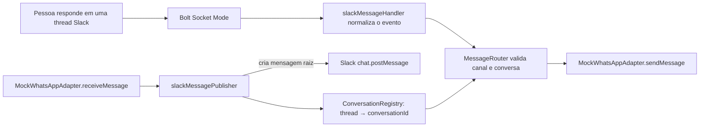

# Parte 1 — Desenvolvimento local com WhatsApp mock

## Objetivo e limite desta etapa

Esta etapa valida o lado Slack da integração e o roteamento da aplicação sem conectar, autenticar ou enviar mensagens para uma conta WhatsApp. O adapter usado é `MockWhatsAppAdapter`, executado no processo local/contêiner.

Há dois tipos de validação:

1. **Testes offline:** exercitam handlers, router, mock e mapeamento de threads sem Slack, rede ou credenciais.
2. **Teste de integração local com Slack:** o container conecta ao Slack real via Socket Mode e publica/recebe mensagens de teste no canal configurado. O WhatsApp continua sendo somente mock.

O estado do mock é salvo em `/data/mock-state.json` dentro do volume Docker `mock_state`. Ele inclui os vínculos de thread e o texto das últimas 500 mensagens capturadas. Trate esse volume como dado privado da equipe e faça backup antes de removê-lo.



## Preparação

Requisitos:

- Docker Compose para a integração local;
- Node.js 20 ou superior para rodar os testes offline diretamente;
- app Slack com Socket Mode habilitado;
- `SLACK_BOT_TOKEN` (Bot User OAuth Token), `SLACK_APP_TOKEN` (App-Level Token) e `SLACK_CHANNEL_ID` no `.env` da raiz.

Os valores dos tokens são secretos: não os inclua em documentação, comandos, screenshots, commits ou logs. O app token precisa de `connections:write`. Para receber mensagens de canal, assine `message.channels` e conceda `channels:history`; para canal privado, use `message.groups` e `groups:history`. Para publicar mensagens de teste, o bot precisa de `chat:write` e precisa ser membro do canal. Consulte a documentação Slack para [Socket Mode](https://docs.slack.dev/tools/bolt-js/concepts/socket-mode/), [eventos de mensagem](https://docs.slack.dev/tools/bolt-js/creating-an-app/#subscribing-to-events) e [`chat.postMessage`](https://docs.slack.dev/reference/methods/chat.postMessage/).

## Rodar os testes offline

Na pasta `upstream/WhatsAppInSlack/app`, execute:

```powershell
npm test
```

São testes unitários do Node (`node:test`). Eles não iniciam Bolt, não leem o `.env`, não acessam Slack e não iniciam WhatsApp.

Na pasta `upstream/WhatsAppInSlack`, os mesmos testes também podem ser executados na imagem Compose:

```powershell
docker compose --env-file ../../.env run --build --rm --no-deps app npm test
```

Esse comando substitui o comando de inicialização do app pelo runner de testes; não abre conexão Socket Mode. O Compose ainda carrega as variáveis exigidas pelo serviço.

## Rodar a integração local com Slack

Na pasta `upstream/WhatsAppInSlack`:

```powershell
docker compose --env-file ../../.env up --build -d
Invoke-RestMethod http://127.0.0.1:3000/health
```

O health esperado inclui `status: ok`, `slack: started` e `whatsappAdapter: mock`. O serviço é exposto somente em `127.0.0.1:3000`.

### Validar uma resposta humana Slack → mock

O router só encaminha respostas a threads que estejam mapeadas para uma conversa. Crie uma mensagem raiz de teste via endpoint local:

```powershell
$testThread = Invoke-RestMethod -Method Post `
  http://127.0.0.1:3000/mock/whatsapp/send-test
$testThread | Select-Object status, conversationId, threadTs
```

Isso simula uma mensagem recebida do WhatsApp e publica uma mensagem identificada como mock no canal Slack configurado. É um **envio real ao Slack**, não um envio ao WhatsApp. Repita a chamada para criar outras conversas mock; cada thread criada fica mapeada de forma persistente.

No Slack, responda **dentro da thread** recém-criada. A resposta humana percorre Bolt → handler → router → mock. Uma mensagem nova no canal, fora de uma thread mapeada, chega ao router, mas é rejeitada com `conversation-not-found` para não ser enviada a uma conversa indeterminada.

Consulte localmente o inbox e os contadores:

```powershell
Invoke-RestMethod http://127.0.0.1:3000/mock/whatsapp/messages
Invoke-RestMethod http://127.0.0.1:3000/debug/router
```

O inbox contém o texto da mensagem humana, portanto mantenha o endpoint local e não copie a resposta para logs ou relatórios sem necessidade.

O endpoint pode criar várias conversas mock por execução. Cada thread e cada mensagem capturada são persistidas; após reiniciar o container, respostas nas threads já registradas continuam associadas à conversa mock correta.

Para encerrar:

```powershell
docker compose --env-file ../../.env down
```

## Cobertura validada até aqui

| Cenário | Evidência |
|---|---|
| Evento humano normalizado e entregue ao `MessageRouter` | Teste offline; também observado via Socket Mode |
| Resposta Slack encaminhada ao mock com texto original | Teste offline e comparação da resposta real no Slack com o inbox mock |
| Resolução do `conversationId` pelo `thread_ts` da thread raiz | Teste offline e thread Slack real |
| Mensagem de bot não retorna ao mock | Teste offline; publicação mock no Slack não gerou entrega ao inbox |
| Canal diferente do `SLACK_CHANNEL_ID` | Teste offline do `MessageRouter` |
| Thread sem mapeamento | Teste offline; mensagem humana fora da thread foi rejeitada em execução real |
| Slack rejeita publicação | Teste offline; nenhum mapeamento é registrado nessa falha |

Os sete testes atuais ficam em `upstream/WhatsAppInSlack/app/test/messageRouting.test.js`. O container usado nesta etapa iniciou saudável e os sete testes passaram via Compose.

As alterações recentes para persistência e múltiplas conversas ainda não têm validação automatizada registrada.

## Mapa de manutenção: onde corrigir

| Sintoma ou regra a alterar | Arquivo responsável |
|---|---|
| Socket Mode, startup, endpoints locais ou assinatura `app.message()` | `upstream/WhatsAppInSlack/app/app.js` |
| Ignorar bot/subtypes e converter o evento Slack para campos normalizados | `upstream/WhatsAppInSlack/app/slackMessageHandler.js` |
| Canal permitido, conteúdo válido, resolução da conversa e chamada a `sendMessage()` | `upstream/WhatsAppInSlack/app/application/MessageRouter.js` |
| Chave que associa canal + thread raiz a `conversationId` | `upstream/WhatsAppInSlack/app/adapters/slack/ConversationRegistry.js` e `app/persistence/JsonStateStore.js` |
| Mensagens capturadas e eventos simulados pelo WhatsApp mock | `upstream/WhatsAppInSlack/app/adapters/MockWhatsAppAdapter.js` |
| Formato de publicação no Slack e registro da thread após sucesso | `upstream/WhatsAppInSlack/app/slackMessagePublisher.js` |
| Cenários de roteamento, loop, canal e threads | `upstream/WhatsAppInSlack/app/test/messageRouting.test.js` |
| Variáveis injetadas, porta local e healthcheck | `upstream/WhatsAppInSlack/docker-compose.yml` |
| Runtime e instalação de dependências | `upstream/WhatsAppInSlack/Dockerfile` e `app/package.json` |

### Limites intencionais do mock

- O inbox persiste apenas as últimas 500 mensagens capturadas; o conteúdo inclui texto enviado pela equipe no Slack.
- Só mensagens de texto estão implementadas neste caminho.
- O `MessageRouter` exige uma thread previamente registrada para identificar a conversa WhatsApp de destino.
- Nenhum cliente, QR code, sessão ou credencial WhatsApp é iniciado ou requerido.
- Persistência de mídia e adapter WhatsApp real são etapas futuras e não devem ser introduzidos ao alterar esta parte sem decisão explícita de arquitetura.

## Diagnóstico seguro de credenciais

Não rode `docker compose config` sem `--quiet`, `docker inspect` com saída integral, `printenv` ou dumps de ambiente. Esses comandos podem expor tokens. Para validar apenas a sintaxe do Compose use:

```powershell
docker compose --env-file ../../.env config --quiet
```

Se aparecer `invalid_auth`, confira no `.env` que `SLACK_BOT_TOKEN`, `SLACK_APP_TOKEN` e `SLACK_CHANNEL_ID` são linhas separadas, sem valores colados por falta de quebra de linha; depois confirme no Slack os tipos dos tokens e o Socket Mode. Não imprima os valores para depurar.
